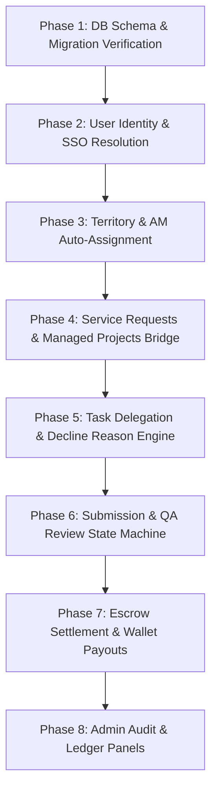

# Azeem Backend Implementation Specification & Handoff

**Target Systems:** Central Hub Solutions (`McomSolutions`) & 247GBS Affiliates (`247gbsaffiliates`)  
**Context:** Preserved Frontend Architectures & Workflows after Backend Restoration  
**Date:** November 8, 2026  
**Status:** Ready for Backend Architecture & Implementation  

---

## Executive Summary & Alignment

As requested by Azeem:
> *"Just revert all and send me a full doc of all of the changes needed. Pls send them with context like the pages / component, the issue, the result we want to achieve."*

All backend changes introduced during local integration have been **completely reverted** on dedicated branches (`realign/dev-2026-11-08`) tracking `origin/dev`.
- In `McomSolutions`: `apps/backend/` has **zero** diff against `origin/dev`.
- In `247gbsaffiliates`: `apps/api/` has **zero** diff against `origin/dev`.
- **All frontend redesigns, components, responsive layouts, review queues, and state hooks have been 100% preserved.**

This specification documents **WHAT** the backend must achieve to power the live frontend user experience, referencing exact frontend files, routes, components, and API call signatures. The architectural choices, database schema decisions, and internal service organization are left entirely to Azeem.

---

## Table of Contents

1. [Architectural Contracts & Cross-System Standards](#1-architectural-contracts--cross-system-standards)
   - 1.1 User Identity Mapping (`mcomUserId`)
   - 1.2 Task & Project Identifier Mapping
   - 1.3 Affiliate Eligibility & Qualification Rules
   - 1.4 Delegation Quotas & Unfunded Projects
   - 1.5 Standard API Envelope & Error Handling
2. [End-to-End Workflow Specifications (1 through 14)](#2-end-to-end-workflow-specifications)
   - [WF-01: CHS Admin Manages Businesses, Affiliates & Account Managers](#wf-01-chs-admin-manages-businesses-affiliates--account-managers)
   - [WF-02: Business Submits a Service Request](#wf-02-business-submits-a-service-request)
   - [WF-03: CHS Auto-Assigns Dedicated Account Manager (Territory/Workload)](#wf-03-chs-auto-assigns-dedicated-account-manager-territoryworkload)
   - [WF-04: Account Manager Receives, Clarifies, and Quotes Request](#wf-04-account-manager-receives-clarifies-and-quotes-request)
   - [WF-05: Account Manager Converts Request into Managed Project](#wf-05-account-manager-converts-request-into-managed-project)
   - [WF-06: Account Manager Creates Managed Project Tasks](#wf-06-account-manager-creates-managed-project-tasks)
   - [WF-07: Account Manager Discovers & Delegates Work to Eligible Affiliates](#wf-07-account-manager-discovers--delegates-work-to-eligible-affiliates)
   - [WF-08: Agent Receives, Accepts, or Declines Tasks (with Reason)](#wf-08-agent-receives-accepts-or-declines-tasks-with-reason)
   - [WF-09: Agent Submits Deliverables, Notes & Supporting Materials](#wf-09-agent-submits-deliverables-notes--supporting-materials)
   - [WF-10: Account Manager Reviews Deliverables (QA & Revisions)](#wf-10-account-manager-reviews-deliverables-qa--revisions)
   - [WF-11: Business Reviews & Approves Deliverables](#wf-11-business-reviews--approves-deliverables)
   - [WF-12: Project Status & Closure Synchronization](#wf-12-project-status--closure-synchronization)
   - [WF-13: Escrow Settlement & Affiliate Wallet Payouts](#wf-13-escrow-settlement--affiliate-wallet-payouts)
   - [WF-14: Admin End-to-End Operational Monitoring](#wf-14-admin-end-to-end-operational-monitoring)
3. [Implementation Priority & Dependency Graph](#3-implementation-priority--dependency-graph)
4. [Outstanding Architectural Decisions for Azeem](#4-outstanding-architectural-decisions-for-azeem)

---

# 1. Architectural Contracts & Cross-System Standards

### 1.1 User Identity Mapping (`mcomUserId`)
- **Central Hub Solutions (CHS)** is the authority for user identity in the ecosystem (`User` table with UUID `id`).
- **247GBS Affiliates** maintains its own `users` table (`id` UUID).
- Every 247GBS user who signs in via Central Hub SSO receives an `mcomUserId` stored in `247gbsaffiliates.users.mcomUserId`.
- **Contract Rule:** Central Hub's task delegation engine (`AffiliateTaskService`) only recognizes `mcomUserId`. If 247GBS sends its local directory UUID `users.id` to Central Hub, Central Hub fails with `404 Assignee not found in Central Hub`.
- **Requirement:** 247GBS backend must translate internal affiliate IDs to `mcomUserId` before communicating with Central Hub, or the delegation endpoint must accept and validate both.

### 1.2 Task & Project Identifier Mapping
- A task created in Central Hub has a primary UUID `AffiliateTask.id`.
- When displayed or managed in 247GBS, this corresponds to `externalTaskId` (or `id` in the normalized `ManagedTask` frontend interface).
- Similarly, an `AffiliateProject.id` in Central Hub corresponds to `projectId` in 247GBS.
- Status, due dates, review notes, and deliverables must remain synchronized between both databases or proxied in real time.

### 1.3 Affiliate Eligibility & Qualification Rules
To be eligible for delegation by an Account Manager, an affiliate must meet 5 qualification criteria:
1. `role` in `['AGENT', 'CONSULTANT', 'ACCOUNT_MANAGER']`.
2. `status === 'ACTIVE'`.
3. `verificationStatus === 'VERIFIED'`.
4. `isOnboarded === true`.
5. For Agents: `isQuizPassed === true` AND declared `skills.length > 0`.
6. Account link: `mcomUserId` must be present (Central Hub SSO connected).

### 1.4 Delegation Quotas & Unfunded Projects
- Businesses on Central Hub have a tier-based quota of free delegated tasks per billing cycle (e.g. Free Tier = 1, Pro = 5, Enterprise = Unlimited).
- Tasks created beyond quota require upfront payment or fund locking (`POST /business/affiliate/tasks/:id/lock-funds`).
- Tasks requiring payment remain in `UNFUNDED` status until escrow is secured.

### 1.5 Standard API Envelope & Error Handling
The frontend expects JSON responses following either:
- **Direct object/array**, OR
- **Wrapped response:** `{ success: boolean, data: T, message?: string }`
- **Error envelope:** `{ statusCode: number, message: string | string[], error?: string, code?: string }`
  - Specifically, unlinked Central Hub accounts should return 409 Conflict with `{ code: 'AFFILIATE_CENTRAL_ACCOUNT_NOT_LINKED' }`.

---

# 2. End-to-End Workflow Specifications

---

## WF-01: CHS Admin Manages Businesses, Affiliates & Account Managers

### Frontend Context
- **Repository:** `McomSolutions`
- **Routes:** `/admin/users`, `/admin/businesses`, `/admin/membership-plans`, `/admin/app-payments`
- **Components:** `apps/frontend/src/pages/AdminMembershipEditor.tsx`, `apps/frontend/src/components/admin/mcom-pay/WalletActivityPanel.tsx`
- **User Action:** Admin configures membership tiers (setting task quotas `freeDelegatedTasksLimit`), reviews affiliate accounts, and inspects wallet activity across the ecosystem.

### Current Issue
- In `origin/dev`, missing columns in database schema (`acquired_by_affiliate_id`, `membership_tier`) caused Prisma `P2022` runtime errors unless migrations were manually deployed.
- Admin membership plan editor requires backend persistence for delegation quota limits and white-label permissions per plan.

### Expected Result
- Admin navigates to `/admin/membership-plans`, updates quota allowances for plans, and changes take effect immediately on business task quotas.
- Admin navigates to `/admin/app-payments` and views paginated, searchable wallet audit logs.

### Backend Implementation Required
- **Endpoints:**
  - `GET /admin/membership-plans` & `PUT /admin/membership-plans/:id`
  - `GET /admin/app-payments/charges` (Filters: `search`, `status`, `page`, `limit`)
  - `GET /admin/app-payments/wallet-activity` (Filters: `search`, `category`, `type`, `dateFrom`, `dateTo`, `page`, `limit`)
- **Payload Shape (`PUT /admin/membership-plans/:id`):**
  ```json
  {
    "name": "Growth Business Tier",
    "freeDelegatedTasksLimit": 5,
    "hasWhiteLabel": true,
    "priceMonthly": 4900
  }
  ```
- **Response Shape (`GET /admin/app-payments/wallet-activity`):**
  ```json
  {
    "success": true,
    "data": [
      {
        "id": "act_uuid",
        "type": "CREDIT",
        "amount": 7500,
        "balanceBefore": 0,
        "balanceAfter": 7500,
        "currency": "GBP",
        "category": "REWARD",
        "reference": "TASK-102-PAYOUT",
        "createdAt": "2026-11-08T18:00:00Z",
        "user": { "id": "user_uuid", "email": "agent@synergyfy.com", "firstName": "John", "lastName": "Doe" }
      }
    ],
    "total": 1,
    "page": 1,
    "limit": 20,
    "totalPages": 1
  }
  ```

### Acceptance Criteria
- Admin can save `freeDelegatedTasksLimit` on a plan.
- Wallet activity table loads without runtime exceptions or 500 errors.

### Dependencies / Decisions
- Needs Prisma migration deployment alignment in `McomSolutions` production/staging environments.

---

## WF-02: Business Submits a Service Request

### Frontend Context
- **Repository:** `McomSolutions`
- **Route:** `/dashboard/delegated-tasks`
- **Component:** `apps/frontend/src/components/DashboardDelegatedTasks.tsx` (`useCreateServiceRequest` hook)
- **User Action:** Business clicks "Submit Service Request" in modal, enters title, description, desired outcome, urgency, and submits.

### Current Issue
- In `origin/dev`, if a business does not have an assigned Account Manager yet, the request creation can fail or remain orphaned without notification to any manager.

### Expected Result
- The request is saved with status `SUBMITTED`.
- The request automatically links to the business's assigned Account Manager (or triggers auto-assignment of an Account Manager if none is assigned).
- The Account Manager sees this request immediately in their 247GBS request queue.

### Backend Implementation Required
- **Endpoint:** `POST /business/affiliate/requests`
- **Auth:** Bearer JWT (Business user).
- **Request Payload:**
  ```json
  {
    "title": "On-Site Store Promotion Campaign",
    "description": "Distribute 500 flyers and register 20 retail leads in Bristol city centre.",
    "desiredOutcome": "20 verified retailer sign-ups",
    "urgency": "NORMAL"
  }
  ```
- **Response Structure:**
  ```json
  {
    "success": true,
    "data": {
      "id": "req_uuid",
      "businessId": "biz_uuid",
      "accountManagerId": "am_uuid",
      "title": "On-Site Store Promotion Campaign",
      "description": "Distribute 500 flyers...",
      "desiredOutcome": "20 verified retailer sign-ups",
      "urgency": "NORMAL",
      "status": "SUBMITTED",
      "createdAt": "2026-11-08T14:30:00Z",
      "business": {
        "id": "biz_uuid",
        "businessName": "Acme Retail Ltd",
        "email": "owner@acmeretail.co.uk"
      }
    }
  }
  ```

### Acceptance Criteria
- Successfully returns 201 Created with the persisted request.
- Request appears in `GET /business/affiliate/requests` for the business and `GET /account-manager/managed-requests` for the AM.

---

## WF-03: CHS Auto-Assigns Dedicated Account Manager (Territory/Workload)

### Frontend Context
- **Repository:** `McomSolutions`
- **Route:** `/dashboard/account-manager` and `/dashboard/delegated-tasks`
- **Component:** `apps/frontend/src/components/DashboardAccountManager.tsx`
- **Hook:** `useAccountManager()` -> `GET /business/affiliate/account-manager`
- **User Action:** Page loads; if no AM is assigned or if the business requests reassignment (`POST /business/affiliate/account-manager/reassign`), CHS resolves an AM.

### Current Issue
- If postcode matching yields no local AM, or if the user's location is missing, assignment fails unless a resilient fallback is executed.

### Expected Result
- Backend checks business postcode against active Account Managers' coverage areas.
- If a geographic match is found, assigns the manager with the lowest workload.
- If no geographic match is found, falls back to the active Account Manager with the fewest assigned businesses.
- Returns full AM profile and contact details to the business.

### Backend Implementation Required
- **Endpoints:**
  - `GET /business/affiliate/account-manager`
  - `POST /business/affiliate/account-manager/reassign`
- **Response Structure:**
  ```json
  {
    "success": true,
    "data": {
      "assigned": true,
      "accountManager": {
        "userId": "mcom_am_uuid",
        "name": "Sarah Jenkins",
        "email": "sarah.am@synergyfy.com",
        "phone": "+44 7700 900123",
        "rating": 4.9,
        "activeProjectsCount": 4,
        "assignedBusinessesCount": 12,
        "bio": "Senior Account Manager specialising in South West retail."
      },
      "assignedAt": "2026-11-08T10:00:00Z"
    }
  }
  ```

### Acceptance Criteria
- Even with an unknown or missing postcode, `GET /business/affiliate/account-manager` assigns an active AM instead of returning a 500 error.

---

## WF-04: Account Manager Receives, Clarifies, and Quotes Request

### Frontend Context
- **Repository:** `247gbsaffiliates`
- **Route:** `/dashboard/account-manager/tasks` (Tab: "Service Requests")
- **Component:** `apps/web/components/dashboard/AccountManagerReviewQueue.tsx`
- **Hooks:** `useManagedRequests()`, `clarify()`, `quote()` in `apps/web/hooks/useTasks.ts`
- **User Actions:**
  - AM clicks "Request Clarification" -> enters note.
  - AM clicks "Quote Service" -> enters estimated cost, currency, and notes.

### Current Issue
- In `247gbsaffiliates`, the route `/account-manager/managed-requests` was returning an empty list or 503 error if the Central Hub upstream endpoint was unreachable or unauthenticated.

### Expected Result
- AM views all requests submitted by businesses assigned to them.
- Clarification changes request status to `CLARIFICATION_REQUESTED` and posts the note to the business.
- Quoting changes request status to `QUOTED` with `estimatedCost` and `currency`.

### Backend Implementation Required
- **Endpoints:**
  - `GET /account-manager/managed-requests` (Query: `status`, `search`, `limit`)
  - `POST /account-manager/managed-requests/:id/clarify` -> Payload: `{ "note": "Please clarify preferred start date." }`
  - `POST /account-manager/managed-requests/:id/quote` -> Payload: `{ "estimatedCost": 250, "currency": "GBP", "notes": "Covers 2 agents for 1 day." }`
- **Status Transitions:**
  - `SUBMITTED` -> `CLARIFICATION_REQUESTED`
  - `SUBMITTED` | `CLARIFICATION_REQUESTED` -> `QUOTED`

### Acceptance Criteria
- Request status in both CHS and 247GBS updates to `QUOTED` or `CLARIFICATION_REQUESTED`.

---

## WF-05: Account Manager Converts Request into Managed Project

### Frontend Context
- **Repository:** `247gbsaffiliates`
- **Route:** `/dashboard/account-manager/tasks` (Tab: "Service Requests" -> "Convert to Project" button)
- **Component:** `apps/web/components/dashboard/AccountManagerReviewQueue.tsx` (`ConvertRequestModal`)
- **Hook:** `convert()` in `apps/web/hooks/useTasks.ts`
- **User Action:** AM enters project title, description, objective, due date, and toggles whether business approval is required.

### Current Issue
- Conversion requires atomic creation of an `AffiliateProject` linked to the `BusinessServiceRequest`, transitioning the request status to `CONVERTED`.

### Expected Result
- A new `ManagedProject` is created in status `ACTIVE`.
- The originating service request status becomes `CONVERTED` and links to the new project ID.
- The project is immediately visible under the AM's "Managed Projects" tab and the Business's project list.

### Backend Implementation Required
- **Endpoint:** `POST /account-manager/managed-requests/:requestId/convert`
- **Payload:**
  ```json
  {
    "project": {
      "title": "Bristol Retail Expansion",
      "description": "Execute city centre merchant acquisition and lead generation.",
      "objective": "Acquire 20 signed retail merchants",
      "dueAt": "2026-11-30T17:00:00Z",
      "requiresBusinessApproval": true
    }
  }
  ```
- **Response Structure:**
  ```json
  {
    "success": true,
    "data": {
      "id": "proj_uuid",
      "requestId": "req_uuid",
      "title": "Bristol Retail Expansion",
      "description": "Execute city centre merchant acquisition...",
      "objective": "Acquire 20 signed retail merchants",
      "status": "ACTIVE",
      "dueAt": "2026-11-30T17:00:00Z",
      "business": { "id": "biz_uuid", "businessName": "Acme Retail Ltd" },
      "tasks": []
    }
  }
  ```

### Acceptance Criteria
- `GET /account-manager/managed-projects` returns the newly converted project.

---

## WF-06: Account Manager Creates Managed Project Tasks

### Frontend Context
- **Repository:** `247gbsaffiliates`
- **Route:** `/dashboard/account-manager/tasks` (Project Card -> "Add Task" button)
- **Component:** `apps/web/components/dashboard/AccountManagerReviewQueue.tsx`
- **Hook:** `useManagedProjects().createProjectTask` in `apps/web/hooks/useTasks.ts`
- **User Action:** AM creates task with title, description, category (`EXTERNAL` | `INTERNAL`), required skills, deliverables specification, materials links, due date, optional prerequisite task ID, and optional initial assignee.

### Current Issue
- The project task creation endpoint must accept unassigned tasks (`assigneeUserId = null` or omitted) without crashing, setting status to `OPEN`.

### Expected Result
- Task is created under the project.
- If `assigneeUserId` is provided, status is `ASSIGNED`.
- If `assigneeUserId` is omitted, status is `OPEN` (waiting for delegation).
- Task inherits `businessId` from the parent project.

### Backend Implementation Required
- **Endpoint:** `POST /account-manager/managed-projects/:projectId/tasks`
- **Payload:**
  ```json
  {
    "title": "Merchant Discovery & Flyer Distribution",
    "description": "Visit High Street retailers and document interested store owners.",
    "category": "EXTERNAL",
    "requiredSkills": ["Direct Sales", "Retail Outreach"],
    "deliverables": "Spreadsheet of 20 verified retailer names, phone numbers, and signed flyers.",
    "materials": "https://drive.google.com/flyer-pack-v1.pdf",
    "dueAt": "2026-11-20T18:00:00Z",
    "assigneeUserId": null,
    "prerequisiteTaskId": null,
    "requiresApproval": true
  }
  ```
- **Response Structure:**
  ```json
  {
    "success": true,
    "data": {
      "id": "task_uuid",
      "projectId": "proj_uuid",
      "title": "Merchant Discovery & Flyer Distribution",
      "status": "OPEN",
      "category": "EXTERNAL",
      "requiredSkills": ["Direct Sales", "Retail Outreach"],
      "deliverables": "Spreadsheet of 20 verified...",
      "materials": "https://drive.google.com/flyer-pack-v1.pdf",
      "dueAt": "2026-11-20T18:00:00Z",
      "assigneeUserId": null,
      "requiresBusinessApproval": true,
      "createdAt": "2026-11-08T15:00:00Z"
    }
  }
  ```

### Acceptance Criteria
- Task is saved in both databases (or proxied) and appears in project tasks list.

---

## WF-07: Account Manager Discovers & Delegates Work to Eligible Affiliates

### Frontend Context
- **Repository:** `247gbsaffiliates`
- **Route:** `/dashboard/account-manager/tasks` & `/dashboard/account-manager/agents`
- **Component:** `apps/web/components/dashboard/AccountManagerReviewQueue.tsx` (`AffiliatePickerDropdown`)
- **Hooks:**
  - `useDelegatableAgents()` -> `GET /account-manager/agents?scope=delegatable`
  - `useManagedTasks().assignTask` -> `POST /account-manager/managed-tasks/:taskId/assign`
- **User Action:** AM searches eligible affiliates by name, skill, or role, selects one, and clicks "Assign".

### Current Issue
- Azeem's original `resolveCentralAssigneeId` threw a PostgreSQL type error if an email was supplied, and returned 404 in CHS if an internal 247GBS user UUID was sent instead of `mcomUserId`.
- AM needs a list of *only* verified, qualified, active affiliates with linked Central Hub accounts.

### Expected Result
- `GET /account-manager/agents?scope=delegatable` returns qualified affiliates with `mcomUserId`, rating, and active task load.
- When AM selects an affiliate and assigns, backend resolves the affiliate's `mcomUserId`, forwards it to Central Hub, and transitions task status to `ASSIGNED`.

### Backend Implementation Required
- **Endpoints:**
  - `GET /account-manager/agents` (Query: `scope=delegatable`)
  - `POST /account-manager/managed-tasks/:taskId/assign`
- **Payload (`POST .../assign`):**
  ```json
  {
    "assigneeUserId": "affiliate_user_id_or_mcomUserId",
    "note": "Priority task for our key retail client. Please review the attached flyer guide."
  }
  ```
- **Response Structure:**
  ```json
  {
    "success": true,
    "data": {
      "id": "task_uuid",
      "status": "ASSIGNED",
      "assigneeUserId": "mcom_user_uuid",
      "assignedAgentName": "Alex Rivera",
      "assignedAgentEmail": "alex.agent@synergyfy.com",
      "assignedAt": "2026-11-08T15:30:00Z"
    }
  }
  ```

### Acceptance Criteria
- If affiliate is not linked to Central Hub, returns 409 Conflict with code `AFFILIATE_CENTRAL_ACCOUNT_NOT_LINKED`.
- If successfully assigned, task status changes to `ASSIGNED` and agent is notified.

---

## WF-08: Agent Receives, Accepts, or Declines Tasks (with Reason)

### Frontend Context
- **Repository:** `247gbsaffiliates`
- **Routes:** `/dashboard/agent/tasks` and `/dashboard/agent/tasks/[id]`
- **Component:** `apps/web/app/dashboard/agent/tasks/[id]/page.tsx`
- **Hooks:** `acceptTask()`, `declineTask()` in `apps/web/hooks/useTasks.ts`
- **User Actions:**
  - Agent clicks "Accept Task"
  - Agent clicks "Decline Task", enters mandatory decline reason, and submits.

### Current Issue
- In Central Hub, the database column `decline_reason` in `AffiliateTask` was only added in migration `20261107120000`. Declining previously failed with Prisma P2022 if migrations were unapplied.

### Expected Result
- If Accepted: Task status transitions to `ACCEPTED` (or `IN_PROGRESS`), records `acceptedAt`.
- If Declined: Task status transitions back to `OPEN` (or `DECLINED`), records `declineReason`, notifies AM so they can reassign to another affiliate.

### Backend Implementation Required
- **Endpoints:**
  - `POST /tasks/:taskId/accept` -> Payload: `{}`
  - `POST /tasks/:taskId/decline` -> Payload: `{ "reason": "Already at full capacity for South West field visits this week." }`
- **Status Transitions:**
  - `ASSIGNED` -> `ACCEPTED` / `IN_PROGRESS`
  - `ASSIGNED` -> `OPEN` (with `declineReason` stored)

### Acceptance Criteria
- Declined task immediately shows `OPEN` in AM queue with the decline reason displayed.

---

## WF-09: Agent Submits Deliverables, Notes & Supporting Materials

### Frontend Context
- **Repository:** `247gbsaffiliates`
- **Route:** `/dashboard/agent/tasks/[id]`
- **Component:** `apps/web/app/dashboard/agent/tasks/[id]/page.tsx`
- **Hook:** `submitTask()` in `apps/web/hooks/useTasks.ts`
- **User Action:** Agent uploads deliverables/files, enters submission notes and materials URLs, and clicks "Submit Deliverables".

### Current Issue
- Frontend expects `submissionData` or `{ deliverables, materialsUrl, notes }` to be saved on the task record and status updated to `SUBMITTED`.

### Expected Result
- Task status changes to `SUBMITTED`.
- Submission timestamp `submittedAt` is recorded.
- Task enters the Account Manager's Review / QA queue.

### Backend Implementation Required
- **Endpoint:** `POST /tasks/:taskId/submit`
- **Payload:**
  ```json
  {
    "notes": "Completed outreach to 22 retailers. Spreadsheet and photos uploaded.",
    "materialsUrl": "https://drive.google.com/folder-bristol-proofs",
    "deliverables": "Attached 22 leads sheet and signed acknowledgement receipts."
  }
  ```
- **Response Structure:**
  ```json
  {
    "success": true,
    "data": {
      "id": "task_uuid",
      "status": "SUBMITTED",
      "submittedAt": "2026-11-08T16:00:00Z",
      "submissionData": {
        "notes": "Completed outreach to 22 retailers...",
        "materialsUrl": "https://drive.google.com/folder-bristol-proofs",
        "deliverables": "Attached 22 leads sheet..."
      }
    }
  }
  ```

### Acceptance Criteria
- Task status becomes `SUBMITTED`. Agent view shows "In Review".

---

## WF-10: Account Manager Reviews Deliverables (QA & Revisions)

### Frontend Context
- **Repository:** `247gbsaffiliates`
- **Route:** `/dashboard/account-manager/tasks` (Tab: "Deliverable QA / Reviews")
- **Component:** `apps/web/components/dashboard/AccountManagerReviewQueue.tsx` (`ReviewTaskModal`)
- **Hook:** `useManagedTasks().reviewTask` in `apps/web/hooks/useTasks.ts`
- **User Actions:**
  - AM selects "Approve Deliverables" -> submits with optional notes.
  - AM selects "Request Revisions" -> submits with mandatory revision feedback notes.

### Current Issue
- Review endpoint must route properly depending on whether the task has `requiresBusinessApproval === true`.

### Expected Result
- **If Changes Requested:** Status transitions to `REVISION_REQUESTED`, `revisionCount` increments, revision notes recorded. Agent is notified and can edit/resubmit.
- **If Approved & `requiresBusinessApproval === true`:** Status transitions to `PENDING_BUSINESS_APPROVAL`. Notifies the business.
- **If Approved & `requiresBusinessApproval === false`:** Status transitions directly to `COMPLETED`. Triggers escrow payout (WF-13).

### Backend Implementation Required
- **Endpoint:** `POST /account-manager/managed-tasks/:taskId/review`
- **Payload:**
  ```json
  {
    "decision": "APPROVED",
    "notes": "Verified all 22 contact records and shop photos. Meets QA standards."
  }
  ```
  *Or for revisions:*
  ```json
  {
    "decision": "CHANGES_REQUESTED",
    "notes": "Lead sheet lines 14-16 are missing valid phone numbers. Please obtain and update."
  }
  ```

### Acceptance Criteria
- Revision request shows a prominent amber banner on the Agent's task page with the feedback notes.

---

## WF-11: Business Reviews & Approves Deliverables

### Frontend Context
- **Repository:** `McomSolutions`
- **Route:** `/dashboard/delegated-tasks` (Section: "Pending Approval" / Tasks table)
- **Component:** `apps/frontend/src/components/DashboardDelegatedTasks.tsx`
- **Hook:** `useReviewAffiliateTask()` in `apps/frontend/src/services/business/hooks.ts`
- **User Action:** Business views submitted materials and clicks "Approve Work" or "Request Changes".

### Current Issue
- In `origin/dev`, `POST /business/affiliate/tasks/:id/review` must update task status to `COMPLETED` upon approval and trigger financial settlement.

### Expected Result
- Approval sets task status to `COMPLETED`, records `businessApprovedAt`.
- Releases escrow funds and initiates agent wallet credit.
- If all tasks in the project are complete, prompts project closure.

### Backend Implementation Required
- **Endpoint:** `POST /business/affiliate/tasks/:id/review`
- **Payload:**
  ```json
  {
    "approved": true,
    "feedback": "Excellent work. Leads were contacted and verified."
  }
  ```
- **Response Structure:**
  ```json
  {
    "success": true,
    "data": {
      "id": "task_uuid",
      "status": "COMPLETED",
      "businessApprovedAt": "2026-11-08T16:30:00Z"
    }
  }
  ```

### Acceptance Criteria
- Task status changes to `COMPLETED`. Business sees task in "Completed Tasks" history.

---

## WF-12: Project Status & Closure Synchronization

### Frontend Context
- **Repositories:** `247gbsaffiliates` & `McomSolutions`
- **Routes:**
  - 247GBS: `/dashboard/account-manager/tasks` (Project Card -> "Close Project")
  - CHS: `/dashboard/delegated-tasks` (Managed Projects -> "Close Project")
- **Components:** `AccountManagerReviewQueue.tsx` & `DashboardDelegatedTasks.tsx`
- **User Action:** AM or Business enters outcome summary, follow-up notes, and confirms closure.

### Current Issue
- When a project is closed from one system, the status in the counterpart system must synchronize.

### Expected Result
- Project validates that no tasks remain in `OPEN`, `ASSIGNED`, `IN_PROGRESS`, or `SUBMITTED`.
- Project status changes to `CLOSED` or `COMPLETED`.
- `closedAt`, `outcomeSummary`, and `followUpNotes` are saved and visible in both portals.

### Backend Implementation Required
- **Endpoints:**
  - 247GBS: `POST /account-manager/managed-projects/:projectId/close`
  - CHS: `POST /business/affiliate/projects/:projectId/close`
- **Payload:**
  ```json
  {
    "outcomeSummary": "Campaign delivered 22 verified retail leads, exceeding target of 20.",
    "followUpNotes": "Schedule follow-up onboarding call next Tuesday."
  }
  ```
- **Response Structure:**
  ```json
  {
    "success": true,
    "data": {
      "id": "proj_uuid",
      "status": "CLOSED",
      "closedAt": "2026-11-08T17:00:00Z",
      "outcomeSummary": "Campaign delivered 22 verified retail leads...",
      "followUpNotes": "Schedule follow-up onboarding call..."
    }
  }
  ```

### Acceptance Criteria
- Project status displays `CLOSED` across both platforms.

---

## WF-13: Escrow Settlement & Affiliate Wallet Payouts

### Frontend Context
- **Repositories:** `247gbsaffiliates` (`/dashboard/account-manager/revenue`, `/wallet`) & `McomSolutions` (`/admin/app-payments`)
- **Components:** `apps/web/components/dashboard/McomWalletPanel.tsx`, `apps/frontend/src/components/admin/mcom-pay/WalletActivityPanel.tsx`
- **Hook:** `useMcomWallet()` in `apps/web/hooks/useMcomWallet.ts`

### Current Issue
- Payout triggers and ledger recordings must happen atomically to prevent double payouts or lost ledger records.

### Expected Result
- Upon task completion:
  1. If funded via escrow, escrow hold is captured.
  2. If funded via quota, quota counter is decremented.
  3. Affiliate's MCOM Central Wallet is credited with reward amount.
  4. Immutable entry written to `WalletActivity` and `AppLedgerEntry`.
  5. Affiliate sees updated balance and transaction item in their wallet dashboard.

### Backend Implementation Required
- **Endpoints:**
  - `GET /wallet/mcom` (Query: `page`, `limit`)
  - Internal settlement service in Central Hub invoked upon task `COMPLETED`.
- **Response Structure (`GET /wallet/mcom` in 247GBS):**
  ```json
  {
    "success": true,
    "data": {
      "balance": 150.00,
      "pendingBalance": 0.00,
      "currency": "GBP",
      "transactions": [
        {
          "id": "tx_uuid",
          "amount": 75.00,
          "type": "CREDIT",
          "category": "REWARD",
          "reference": "TASK-102-PAYOUT",
          "description": "Payment for Merchant Discovery & Flyer Distribution",
          "createdAt": "2026-11-08T16:30:00Z"
        }
      ]
    }
  }
  ```

### Acceptance Criteria
- Completed task reflects immediately as a CREDIT in `/wallet/mcom`.

---

## WF-14: Admin End-to-End Operational Monitoring

### Frontend Context
- **Repository:** `McomSolutions` (`/admin/app-payments`, `/admin/businesses`) & `247gbsaffiliates` (`/dashboard/admin/tasks`, `/dashboard/admin/reports`)
- **Components:** `apps/frontend/src/components/admin/mcom-pay/WalletActivityPanel.tsx`, `apps/web/app/dashboard/admin/tasks/page.tsx`
- **User Action:** Platform Admin views system-wide health, task bottlenecks, and payment reconciliation.

### Current Issue
- Admin requires visibility across all managed projects and affiliate assignments without permission errors.

### Expected Result
- Admin can query all tasks regardless of business or AM assignment.
- Admin can inspect ledger entries and filter by date, category, and status.

### Backend Implementation Required
- **Endpoints:**
  - `GET /admin/app-payments/charges`
  - `GET /admin/app-payments/wallet-activity`
  - `GET /admin/tasks` (with filters)

### Acceptance Criteria
- Admin views all ecosystem transactions with accurate user and business metadata.

---

# 3. Implementation Priority & Dependency Graph

To guide backend implementation without circular blockers, here is the suggested implementation sequence:



### Priority 1: Schema & Identity Foundation (Non-Negotiable)
1. Ensure all Prisma migrations in `McomSolutions` (`affiliate_business_acquisition`, `membership_tier_delegation_whitelabel`, `decline_reason`) are deployed in target DB.
2. In `247gbsaffiliates`, ensure SSO exchange consistently stores `mcomUserId` in the local `users` table.

### Priority 2: Account Manager Assignment & Requests
1. `GET /business/affiliate/account-manager` with graceful territory/workload fallback.
2. `POST /business/affiliate/requests` & `GET /account-manager/managed-requests`.
3. `POST /account-manager/managed-requests/:id/convert`.

### Priority 3: Project Task Delegation & State Machine
1. `POST /account-manager/managed-projects/:id/tasks` (supporting both unassigned `OPEN` and assigned `ASSIGNED`).
2. `GET /account-manager/agents?scope=delegatable` (returning valid `mcomUserId`s).
3. `POST /tasks/:id/accept` and `POST /tasks/:id/decline` (storing `declineReason`).
4. `POST /tasks/:id/submit` (saving `submissionData`).
5. `POST /account-manager/managed-tasks/:id/review` and `POST /business/affiliate/tasks/:id/review`.

### Priority 4: Financial Settlement & Admin Visibility
1. Escrow release and wallet reward credit upon task completion.
2. `GET /admin/app-payments/wallet-activity` and charges ledger.

---

# 4. Outstanding Architectural Decisions for Azeem

The following architectural questions are surfaced for Azeem's decision:

1. **Service Layer Validation vs. Gateway Filtering:**
   - In `247gbsaffiliates`, should the backend service `AccountManagerService.assignTask` reject unverified affiliates with `403 Forbidden`, OR should the backend purely rely on `GET /account-manager/agents?scope=delegatable` and Central Hub's validation?
   - *Recommendation:* Keep the backend permissive (Azeem's design) while enforcing input type safety (`isUuid` or string sanitization) so PostgreSQL does not throw syntax errors.

2. **Project Closure Responsibility:**
   - Can both the Account Manager and the Business close a project, or should project closure be restricted solely to the Account Manager with business concurrence?

3. **Multi-Agent Task Delegation:**
   - Does a project task strictly belong to a single affiliate assignee (`assigneeUserId`), or will tasks support split delegations in future iterations? (Currently, the frontend assumes a single assignee per task).

4. **Escrow Hold Timing for Quota vs. Paid Tasks:**
   - Should tasks within a business's free tier quota skip the escrow locking step entirely and transition immediately to `OPEN` / `ASSIGNED`, while only over-quota tasks require `POST .../lock-funds`? (Frontend currently allows immediate creation within quota).

---
*End of Specification. Prepared for Azeem.*

